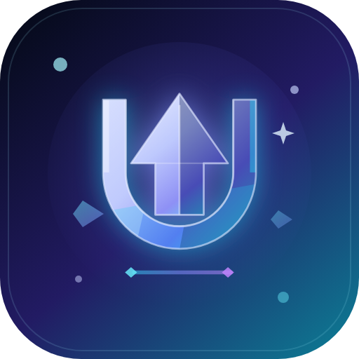

<div align="center">
  

  <h1>UniStore</h1>

  <p><strong>Все обновления Android-приложений — в одном списке.</strong></p>
  <p>Google Play · RuStore · APKPure · F-Droid · Aptoide · магазины производителей</p>

  [](#требования)
  [](#технологии)
  [](#технологии)
  [](../../releases/latest)
  [](#установка)
  [](#качество-и-проверка)
</div>

> **Статус:** активная разработка. Последний релиз — **1.1.7** (versionCode 11). Приложение проверено на Xiaomi `2511FPC34G` (Android 16, HyperOS 3).

**UniStore** — Android-приложение на Kotlin и Jetpack Compose, которое собирает обновления установленных приложений из нескольких магазинов и показывает их в одном списке. Это не магазин и не замена Google Play: UniStore находит версии, сравнивает их с установленными, проверяет совместимость и подпись, скачивает APK/XAPK и передаёт файл системному установщику Android.

Проект вырос из практической задачи: в России Google Play часто доступен только через VPN, а обновления раскиданы по RuStore, APKPure, F-Droid, Aptoide и фирменным каталогам производителей. UniStore собирает всё в одном месте и не требует root.

Интерфейс полностью на русском. Есть четыре темы, семь цветовых схем, адаптивная Material You, сезонное оформление и отдельный режим для слабых устройств.

## Содержание

| | |
|---|---|
| [О проекте](#о-проекте) | [Почему UniStore](#почему-unistore) |
| [Возможности](#возможности) | [Поддерживаемые магазины](#поддерживаемые-магазины) |
| [Последние обновления](#последние-обновления) | [Установка](#установка) |
| [Сборка](#сборка) | [Архитектура](#архитектура) |
| [Технологии](#технологии) | [Качество и проверка](#качество-и-проверка) |
| [Ограничения](#ограничения) | [FAQ](#faq) |
| [Участие в разработке](#участие-в-разработке) | [Лицензия](#лицензия) |

## О проекте

UniStore следит за приложениями, которые вы добавили вручную, и проверяет их во всех включённых источниках параллельно. Результаты появляются по мере готовности: не нужно ждать, пока медленный магазин ответит по последнему приложению. Для каждого источника есть отдельный таймаут, индикатор связи и резервные маршруты на случай блокировки или недоступности.

Приложение не устанавливает APK молча — это невозможно без root и нарушает правила Android. UniStore делает подготовительную работу: находит ссылку, скачивает файл, проверяет пакет, версию, ABI, `minSdk`/`targetSdk` и сертификат, а затем открывает системный установщик. Пользователь подтверждает установку в обычном окне Android.

Данные хранятся локально в DataStore. В проекте нет рекламных SDK, аналитики, аккаунтов и телеметрии.

## Почему UniStore

- **Один список вместо десятка магазинов.** Девять источников с автопроверкой: Google Play, RuStore, APKPure, F-Droid, Aptoide, GetApps, Galaxy Store, V-Appstore и Flyme Store. Плюс семь магазинов производителей для ручного перехода.
- **Только реальные обновления.** Версии сравниваются сначала по числовой части имени, `versionCode` используется при равных именах. Старые и совпадающие версии отбрасываются ещё до интерфейса.
- **Прямая установка APK и XAPK.** RuStore, APKPure, F-Droid и Aptoide отдают файлы напрямую. Поддерживаются split-APK, докачка по HTTP Range и установка нескольких частей одной сессией.
- **Проверка совместимости и подписи.** До системного установщика проверяются пакет, версия, `minSdk`, `targetSdk`, ABI и SHA-1/SHA-256 сертификата. APK с чужой подписью блокируется.
- **Быстро даже на слабом телефоне.** Общий пул соединений, параллельные проверки, короткие таймауты и режим «Слабое устройство». Release-APK занимает около 2 МБ благодаря R8 и удалению неиспользуемых ресурсов.
- **Понятный русский интерфейс.** Material 3, четыре темы, семь палитр, адаптивная схема, сезонные эффекты и аккуратные анимации: запуск за ~1 секунду, переходы из точки нажатия и рассыпающаяся «U».
- **Без рекламы и аккаунтов.** Нет регистрации, подписок, трекеров и рекламных баннеров. Сеть используется только для запросов к магазинам и загрузки APK.
- **Устойчивость к сетевым ограничениям.** Несколько маршрутов и зеркал для APKPure, RuStore, GetApps, Aptoide, Galaxy Store, F-Droid, V-Appstore и Flyme Store. Если маршрут не отвечает, проверка переходит к следующему.

## Возможности

### Проверка обновлений

- Девять автоматических источников, включая магазины производителей.
- Параллельные запросы через общий пул HTTP/2-соединений.
- Отдельные таймауты: 20 секунд для Google Play, 10 для APKPure, 8 для остальных.
- Результаты и счётчики обновляются по ходу проверки, а не после её завершения.
- Автопроверка при запуске, ручная кнопка «Проверить» и необязательная фоновая проверка через WorkManager.
- Индикаторы связи магазинов: зелёный, жёлтый, красный и задержка в миллисекундах.
- Скрытие несовместимых версий: только 32-битный APK на 64-битном телефоне, слишком новый `targetSdk` и другие случаи не попадают в счётчик обновлений.
- Системные приложения скрыты по умолчанию. Дополнительно исключаются фоновые компоненты без MAIN-активности, верификаторы и известные предустановки производителей.

### Загрузка и установка

- Прямая загрузка APK/XAPK для RuStore, APKPure, F-Droid и Aptoide.
- APKPure загружается через невидимый WebView: страница открывается, кнопка скачивания нажимается синтетическим touch-событием, подписанная ссылка `data.winudf.com` скачивается через OkHttp.
- Split-APK: base и все части проверяются отдельно и устанавливаются одной сессией `PackageInstaller`.
- На Android 9 манифест и сертификат split-частей читаются напрямую из архива, потому что `PackageManager` не умеет разбирать их через `getPackageArchiveInfo()`.
- Большие файлы качаются по HTTP Range в четыре соединения (два в режиме слабого устройства) с автоматическим откатом на одно соединение.
- Проверка подписи SHA-1/SHA-256, пакета и версии до передачи файла системе.
- Очистка кэша после установки, отмены загрузки и при запуске после прерванной установки.
- «Обновить всё»: до трёх параллельных загрузок, проверенные файлы ждут своей очереди, системный установщик открывается по одному.

### Интерфейс

- Четыре режима оформления: системный, светлый, тёмный и чёрный AMOLED.
- Семь цветовых схем: адаптивная, стандарт, океан, лес, закат, лаванда, роза.
- Адаптивная схема следует Material You и обоям на Android 12+, а в сезон подстраивается под оформление.
- Сезонные эффекты: снег и гирлянды зимой и на Новый год, листья осенью, паутина, тыквы и летучие мыши на Хэллоуин.
- Быстрая заставка: логотип «Кристалл × U», стрелка, поворот «U» и круговое раскрытие интерфейса.
- Переходы между экранами раскрываются из реальной точки нажатой кнопки: шестерёнки, FAB, ссылки «Настроить», чипов источников и других элементов.
- На заставке «U» рассыпается на 108 осколков, которые летят к краям экрана. Каждый запуск даёт новый узор.
- Режим «Слабое устройство» отключает тяжёлые анимации, сезонные эффекты, shimmer и лишние сетевые запросы.

### Надёжность

- Поиск обновлений не прерывается из-за одного медленного источника.
- Магазин отключается после серии временных ошибок и не тормозит остальные.
- Цепочки резервных маршрутов и зеркал для заблокированных или недоступных магазинов.
- Сохранение настроек, списка приложений и последних результатов в DataStore.
- Очередь установки продолжается после возврата из системного установщика.
- Понятные сообщения об ошибках: недоступен магазин, несовместимая версия, не совпала подпись, не удалось скачать файл.

### Приватность

- Нет аккаунтов, рекламы, аналитики и телеметрии.
- Настройки и список отслеживаемых приложений хранятся только на устройстве.
- Сеть используется для запросов к выбранным магазинам и загрузки APK.
- Приложение не просит root и не устанавливает пакеты без подтверждения пользователя.

## Поддерживаемые магазины

| Магазин | Тип | Автопроверка | Прямая установка | Примечание |
|---|---|:---:|:---:|---|
| Google Play | универсальный | ✅ | — | Открывается страница приложения или раздел обновлений |
| RuStore | универсальный | ✅ | ✅ | APK/XAPK |
| APKPure | универсальный | ✅ | ✅ | APK/XAPK через WebView |
| F-Droid | универсальный | ✅ | ✅ | Выбирается `suggestedVersionCode` |
| Aptoide | универсальный | ✅ | ✅ | APK |
| GetApps | Xiaomi | ✅ | — | На глобальной прошивке используется глобальный каталог |
| Galaxy Store | Samsung | ✅ | — | Раздел обновлений |
| V-Appstore | vivo / iQOO | ✅ | — | Раздел обновлений |
| Flyme Store | Meizu | ✅ | — | Раздел обновлений |
| AppGallery | Huawei | — | — | Ручной переход, включая `ThirdUpdateAction` |
| Honor App Market | Honor | — | — | Ручной переход |
| HeyTap Store | OPPO / realme / OnePlus | — | — | Ручной переход |
| Palm Store | Tecno / Infinix / itel | — | — | Ручной переход |
| Amazon Appstore | Amazon | — | — | Ручной переход |
| Lenovo App Store | Lenovo / Motorola | — | — | Ручной переход |
| ZTE App Store | ZTE / nubia | — | — | Ручной переход |

Магазины без публичного API версий не участвуют в автоматической проверке: UniStore не выдумывает для них обновления, а показывает установленные магазины первыми и открывает их страницы.

## Последние обновления

### 1.1.7 — переходы из точки нажатия и осколки «U»

- Шестерёнка, кнопка «Добавить», «Настроить», чипы источников, hero-кнопка, пустые состояния и «Начать» запоминают свой реальный центр при компоновке.
- Новый экран раскрывается масштабом от нажатого элемента, а возврат сжимается к той же точке. Координаты не зашиты в код.
- «U» на заставке рассыпается на 108 гранёных осколков: 32 крупных кристалла равномерно покрывают направления, остальные летят под случайными углами.
- Осколки вращаются, оставляют светящийся след и долетают до краёв экрана; в центре вспыхивает мягкое ядро и расходятся кольца.
- Каждый запуск даёт новый узор, при этом заставка по-прежнему занимает около 1,05 секунды.

### 1.1.6 — быстрый запуск и системные компоненты

- Новая заставка «Кристалл × U»: появление логотипа, улетающая стрелка, поворот «U» и круговое раскрытие интерфейса.
- Переходы между экранами, hero-блок, карточки и нижний лист раскрываются масштабом от точки, а не сдвигом всего экрана.
- `com.google.android.contactkeys` («Android System Key Verifier») и `com.google.android.verifier` («Проверка разработчика») скрываются на любой прошивке.
- Фоновые компоненты без MAIN-активности больше не попадают в список обновлений.
- Предустановленные приложения определяются по системным флагам, времени установки и заводской метке прошивки.

### 1.1.5 — новый логотип и устойчивость

- Новый логотип «Кристалл × U», адаптивная иконка, splash screen и единый знак во всём приложении.
- Невидимый WebView для APKPure больше не перехватывает касания и не «подвешивает» экран.
- Неудачное обновление с чужой подписью больше не предлагается повторно.
- Google Play открывает карточку конкретного приложения, а не общий раздел «Мои приложения».
- Исправлены ложные обновления для перепакованных приложений с тестовой подписью AOSP и для китайского GetApps на глобальной прошивке.
- Удалённые приложения и магазины автоматически исчезают из отслеживания.

<details>
<summary><strong>Более старые версии (1.1.4 – 1.0.2)</strong></summary>

- **1.1.4** — параллельная загрузка по HTTP Range, стабильная версия F-Droid через `suggestedVersionCode`, переиспользование Cloudflare-сессии APKPure, кэш индикаторов связи.
- **1.1.3** — Amazon Appstore, Lenovo App Store и ZTE App Store; полный каталог магазинов производителей с кнопками «Открыть» и «Сайт».
- **1.1.2** — индикаторы связи магазинов, общий пул HTTP/2-соединений, подсказка про VPN для Google Play, отменяемые HEAD-запросы.
- **1.1.1** — скрытие несовместимых версий и понятный экран, когда совместимых обновлений нет.
- **1.1.0** — параллельная проверка источников, результаты по ходу проверки, индикаторы связи и очередь установки.
- **1.0.2** — APKPure XAPK через WebView, разбор split-APK на Android 9, чтение метаданных из прямой ссылки.

Полная история изменений: [CHANGELOG.md](CHANGELOG.md).

</details>

## Установка

### Требования

- Android 8.0 (API 26) или новее.
- Интернет.
- Разрешение на установку из неизвестных источников — только если пользуетесь прямой установкой APK.

### Шаги

1. Скачайте `UniStore-1.1.7.apk` из [Releases](../../releases/latest) или возьмите файл `UniStore-1.1.7.apk` из корня репозитория.
2. Откройте APK и разрешите установку из этого источника, если Android попросит.
3. При первом запуске выберите источники и нажмите «Начать».
4. Добавьте приложения и нажмите «Проверить».
5. Для прямой установки разрешите UniStore установку неизвестных приложений.

### Контрольная сумма

```text
Файл:    UniStore-1.1.7.apk
Размер:  2 054 303 байт
SHA-256: 905C278640E139CBAABACC68C9E28260858C58867B127B2235D277B47D5C7F4E
```

Проверка в Windows:

```powershell
Get-FileHash .\UniStore-1.1.7.apk -Algorithm SHA256
```

## Сборка

Проект использует JDK 17, Android SDK 35, Gradle 8.11.1 и Android Gradle Plugin 8.7.3. В репозитории есть Gradle Wrapper.

```bash
git clone https://github.com/NetlYouTube/UniStore.git
cd UniStore
./gradlew :app:assembleDebug
```

Release-сборка:

```bash
./gradlew :app:assembleRelease
```

Готовые файлы:

```text
app/build/outputs/apk/debug/app-debug.apk
app/build/outputs/apk/release/app-release.apk
```

Тесты и lint:

```bash
./gradlew :app:testDebugUnitTest :app:lintDebug
```

> **Подпись release.** Параметры keystore читаются из git-игнорируемого `local.properties` или переменных окружения. Создайте свой ключ и добавьте в `local.properties`:
>
> ```properties
> RELEASE_STORE_FILE=keystore/your-release.keystore
> RELEASE_STORE_PASSWORD=your-store-password
> RELEASE_KEY_ALIAS=your-key-alias
> RELEASE_KEY_PASSWORD=your-key-password
> ```
>
> Те же имена можно задать переменными окружения. Если ключ не найден, `assembleRelease` соберёт неподписанный APK. Debug-сборка работает без настроек. Не коммитьте keystore и `local.properties`.

## Архитектура

```text
app/src/main/java/ru/updatehub/app/
├── data/
│   ├── checkers/          # 9 парсеров магазинов и цепочки маршрутов
│   ├── install/           # загрузка, разбор APK/XAPK, подпись, установка
│   ├── AppScanner.kt      # сканирование установленных приложений
│   ├── UpdateRepository.kt
│   ├── SettingsRepository.kt
│   ├── SignatureUtils.kt
│   └── VersionRules.kt
├── notifications/         # WorkManager, уведомления, планировщик
├── ui/
│   ├── components/        # общие Compose-компоненты
│   ├── theme/             # темы, палитры, движение, производительность
│   ├── MainScreen.kt
│   ├── SettingsScreen.kt
│   ├── AddAppsScreen.kt
│   ├── WelcomeScreen.kt
│   ├── LaunchReveal.kt    # заставка и осколки «U»
│   └── PointOrigin.kt     # переходы из точки нажатия
├── AppContainer.kt
├── MainActivity.kt
└── UpdateHubApp.kt
```

Поток проверки:

```text
Compose UI → AppViewModel → UpdateRepository → StoreChecker[]
                                      ↓
                             DataStore / результаты

Compose UI → ApkDownloader → ApkArchiveInspector → ApkInstaller → PackageInstaller
```

## Технологии

| Компонент | Версия / роль |
|---|---|
| Kotlin | 2.0.21 |
| Jetpack Compose | BOM 2024.12.01, Material 3 |
| Navigation Compose | 2.8.5 |
| DataStore Preferences | 1.1.1 |
| WorkManager | 2.10.0 |
| OkHttp | 4.12.0 |
| Coroutines | 1.9.0 |
| Android Gradle Plugin | 8.7.3 |
| Gradle | 8.11.1 |
| JDK | 17 |
| minSdk / targetSdk | 26 / 35 |
| Сборка | R8 + `shrinkResources` |

## Качество и проверка

| Проверка | Результат |
|---|---|
| Unit-тесты | **86/86** |
| Lint | **0 ошибок**, 19 предупреждений |
| Release APK | **2 054 303 байт** |
| SHA-256 | `905C278640E139CBAABACC68C9E28260858C58867B127B2235D277B47D5C7F4E` |
| Тестовое устройство | Xiaomi `2511FPC34G`, Android 16, HyperOS 3 |
| Приложений под наблюдением | 79 |
| Системные верификаторы | Скрыты |
| VPN | подключён |

Тесты покрывают сравнение версий, правила обновлений, сезонные даты, проверку подписей, совместимость Android/ABI, чтение split-APK, HTTP Range, маршруты источников и определение системных приложений.

## Ограничения

- Приложение не устанавливает APK молча: установку подтверждает пользователь в системном окне.
- Google Play не имеет публичного API версий, поэтому страница разбирается как HTML. В России она часто доступна только через VPN.
- Магазины без публичного API (AppGallery, Honor, HeyTap, Palm, Amazon, Lenovo, ZTE) проверяются только вручную.
- Значение «Varies with device» в Google Play считается отсутствием версии.
- Aptoide иногда содержит сторонние загрузки с чужой подписью — такие APK блокируются до установщика.
- Фоновые проверки Android может откладывать для экономии батареи.
- Для проверки обновлений нужен интернет.

## FAQ

<details>
<summary><strong>Почему Google Play иногда показывается как «недоступен»?</strong></summary>

Google Play не отдаёт версии через публичный API, поэтому UniStore читает страницу приложения. В России она часто открывается только через VPN. Если VPN работает в режиме split tunneling, добавьте UniStore в список приложений, которые идут через туннель. Красный кружок и подсказка «проверьте VPN» означают сетевое ограничение, а не ошибку приложения.

</details>

<details>
<summary><strong>Почему обновление не устанавливается автоматически?</strong></summary>

Android запрещает тихую установку APK без root. UniStore скачивает и проверяет файл, после чего открывает системный установщик. Пользователь подтверждает установку вручную — это требование безопасности ОС.

</details>

<details>
<summary><strong>Почему некоторых приложений нет в списке?</strong></summary>

По умолчанию скрыты системные приложения, фоновые компоненты без MAIN-активности, верификаторы и известные предустановки производителей. Проверку системных приложений можно включить в настройках.

</details>

<details>
<summary><strong>Почему версия в UniStore отличается от версии в магазине?</strong></summary>

Магазины могут публиковать разные сборки для регионов, архитектур и каналов обновления. UniStore показывает версию из конкретного источника и проверяет её совместимость с телефоном. Если версия не подходит по ABI или `targetSdk`, она скрывается.

</details>

<details>
<summary><strong>Это безопасно?</strong></summary>

UniStore проверяет пакет, версию и сертификат APK до установки и блокирует файлы с чужой подписью. В проекте нет рекламных и аналитических SDK. Скачиваемые файлы удаляются из кэша после установки или отмены.

</details>

## Участие в разработке

Issues и pull request'ы приветствуются.

- Для баг-репорта укажите модель телефона, версию Android, версию UniStore и фрагмент `logcat` с тегом `UpdateHub`.
- Перед PR запустите `./gradlew :app:testDebugUnitTest :app:lintDebug`.
- Не коммитьте `local.properties`, приватные ключи, скачанные APK и содержимое `tools/`.
- Для новых магазинов приложите пример страницы, с которой снимается версия, и объясните, есть ли у магазина публичный API.

## Лицензия

Проект распространяется по лицензии [Apache License 2.0](LICENSE). Можно использовать, изменять и распространять код, в том числе в коммерческих проектах, при сохранении уведомлений об авторстве. Лицензия также содержит явную передачу патентных прав и не запрещает создавать похожие приложения.

## Дисклеймер

UniStore не связан с Google, RuStore, APKPure, F-Droid, Aptoide, Xiaomi, Samsung, vivo, Meizu, Huawei, Honor, OPPO, realme, OnePlus, Tecno, Infinix, itel, Amazon, Lenovo, Motorola, ZTE и nubia. Все названия и логотипы принадлежат их владельцам.

---

<p align="center">Сделано на Kotlin и Jetpack Compose. Если проект полезен — поставьте ⭐.</p>
